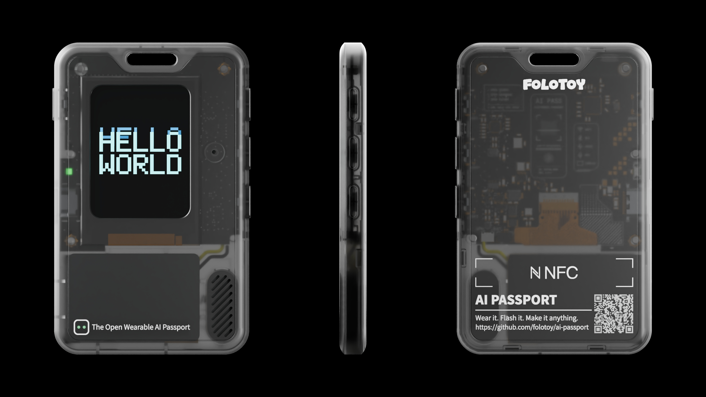

**English** · [简体中文](README.zh_CN.md)

# FoloToy AI Passport — Pet Identity Card Firmware

Firmware for the **FoloToy AI Passport**, a wearable ESP32-C3 device with a
240 × 320 color display. This branch implements the *pet identity card* play: a
small cat companion lives on the screen, and the identity card on the home
screen carries a name, signature, serial number, portrait photo, and one of four
display themes. Everything the user changes is stored in NVS and survives a
power cycle.

<p align="center">
  
</p>

## What is in this firmware

- **Four card themes**: Paper, Dark, Carbon, and Ink (color ink-wash). Each theme
  is a full 240 × 320 RGB565 card face plus its own text colors and text anchors.
- **Animated cat**: 8 hand-drawn frames, 2 extra poses (roll, yarn), a close-up
  frame, and a bed. Frame data is pre-packed as RGB565A8; the firmware never
  rescales frames.
- **Accessories**: study glasses, cool sunglasses and jacket, office outfit.
- **Portrait avatar**: an 88 × 88 RGB565A8 image uploaded from a phone through
  the built-in Wi-Fi portal, stored with A/B redundancy in NVS.
- **Settings screen**: volume, brightness, idle screen, accessory, theme,
  avatar (male/female), phone setup, and language (Chinese/English).
- **Low power**: the backlight dims after 15 s idle and turns off after 30 s. The
  first key press only wakes the screen.
- **Serial screenshot protocol**: a host can pull a full 240 × 320 RGB565 frame
  over the USB Serial/JTAG console.

The full platform documentation, hardware guide, and contributor workflow live
under [`docs/`](docs/README.md).

## Hardware requirements

| Item | Requirement |
| --- | --- |
| MCU | ESP32-C3, 8 MB Flash, **no PSRAM** |
| Display | ST7789P3, 240 × 320, RGB565, SPI |
| Input | UP / DOWN / OK on a GPIO0 ADC resistor ladder, plus a power key |
| Audio | ES8311 codec, built-in microphone and speaker |
| Power | 500 mAh Li-ion cell, CW2017 fuel gauge, USB Type-C |
| Console | Native USB Serial/JTAG (not UART0) |

RAM is tight: the firmware runs entirely from internal SRAM, and the LVGL pool
is deliberately capped. Read
[`docs/development/engineering/build-and-test.md`](docs/development/engineering/build-and-test.md)
before raising buffer sizes.

## Repository layout

| Path | Contents |
| --- | --- |
| `main/` | Application code, LVGL UI, Wi-Fi portal, screenshot protocol |
| `main/*.bin` | Packed runtime resources: card faces, sprites, signs, fonts, sound effects |
| `main/*_info.h` | Generated asset tables. Do not edit by hand. |
| `components/bsp/` | Board support: display, audio, battery, buttons, low power |
| `assets/art/` | Art sources that the packing script consumes |
| `tools/pack_assets.py` | Packs `assets/art/` into `main/*.bin` and regenerates the asset tables |
| `partitions.csv` | Partition table (see constraints below) |
| `sdkconfig.defaults` | Reproducible build configuration |

`build/`, `build_ui/`, `*.elf`, and `*.map` are build outputs and are ignored.

## Build

Requirements: **ESP-IDF v5.5.3** and Python with Pillow (only needed when
regenerating assets).

```bash
idf.py set-target esp32c3
idf.py build
```

Dependencies are pinned in `dependencies.lock` and downloaded from the Espressif
component registry on the first build.

To regenerate the packed resources from `assets/art/`:

```bash
python tools/pack_assets.py
```

The script prints a WCAG contrast line per theme and fails loudly if a card face
is missing; it never silently substitutes a placeholder in a release build.
Formats, offsets, and byte-level checks are documented in
[`asset-pipeline.md`](docs/development/engineering/asset-pipeline.md).

## Flash

Flash the normal build output:

```bash
idf.py -p <PORT> flash
```

Or build a single merged image and write it from address `0x0`:

```bash
python -m esptool --chip esp32c3 merge_bin -o merged.bin \
  --flash_mode dio --flash_size 8MB --flash_freq 80m \
  0x0    build/bootloader/bootloader.bin \
  0x8000 build/partition_table/partition-table.bin \
  0x10000 build/FoloToy-AI-Passport.bin

python -m esptool --chip esp32c3 -p <PORT> write_flash 0x0 merged.bin
```

## Partition table constraints

```
phy_init, data, phy,     0x9000,   0x1000
factory,  app,  factory, 0x10000,  0x6F0000
nvs,      data, nvs,     0x700000, 0x100000
```

- **There is no `ota_data` partition.** This firmware is updated by re-flashing,
  not by OTA.
- The factory app starts at `0x10000` and ends at `0x700000`, so the application
  image must stay below 7,077,888 bytes (6.75 MiB).
- **NVS starts at `0x700000`**, after the app. A whole-image update only touches
  `0x0`…app end, so re-flashing a merged image does not erase user settings. If
  you change the app partition size, move the NVS offset and the guard checks
  together.

## Change the portrait avatar with the Wi-Fi portal

1. On the home screen, **hold OK** to open Settings (a short OK summons the cat).
2. Move to **PHONE SETUP** and press **OK**. The screen shows the access point
   name and password.
3. Join that access point from a phone (the name is `AI-PASSPORT-XXXX`; the
   password is derived from the device MAC and is shown on screen).
4. Open <http://192.168.4.1> and upload an image. The portal crops and converts
   it to an 88 × 88 RGB565A8 portrait and writes it to NVS in chunks.
5. Press **OK** on the device to close the portal; it returns to Settings. The
   home screen reloads the portrait from NVS.

The portal closes itself after **600 s** with no client activity; connecting or
disconnecting a client resets that timer. Uploads are written in A/B banks, so an
interrupted upload leaves the previous portrait intact.

## License

[MIT](LICENSE). Bundled fonts and art assets are covered by their own licenses;
see [`assets/README.md`](assets/README.md) and
[`OFL-LXGWWenKai.txt`](OFL-LXGWWenKai.txt).
