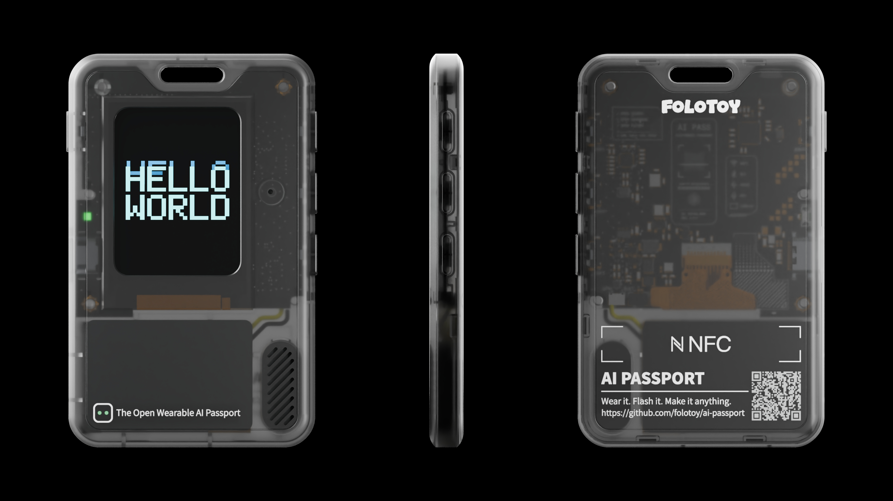

**简体中文** · [English](README.md)

# FoloToy AI Passport —— 灵宠身份卡固件

这是 **FoloToy AI Passport**（ESP32-C3 可穿戴设备，240 × 320 彩色屏）的
「灵宠身份卡」玩法固件：一块小小的猫在屏上活动，首页身份卡带姓名、签名、
编号、证件照，以及四套主题。用户改过的每一项都存在 NVS 里，断电重启仍在。

**当前版本：v1.3**

<p align="center">
  
</p>

## v1.3 更新

- **首页墨点漂浮**：彩色水墨主题的首页现在有 8 颗墨点缓慢漂浮，以墨青为主，
  其中两颗朱砂点缀。墨点只在第 4 套主题的首页出现，进入省电后停止运动。
- **新的内置形象**：女性形象的外套换成暖砖红。脸和发型未改动，男性形象
  也不受影响。
- **配网页在手机浏览器上的乱码修复**：配网门户现在会同时返回
  `Content-Encoding: gzip` 与 `Vary: Accept-Encoding`，修好了部分手机自带
  浏览器打开 <http://192.168.4.1> 时整页乱码的问题。
- **发布产物**：合并固件 5,935,552 字节，SHA-256
  `3762782A52EA0FE23A914AC791FE13DE85B0D80D4401ACC8A6AF979165AD46E3`。

## 这版固件有什么

- **四套卡面主题**：暖纸、深色、酷卡、彩色水墨。每套是完整的 240 × 320
  RGB565 卡面，外加各自的文字色与文字锚点。
- **动起来的猫**：8 帧手绘动作、2 个额外姿态（打滚、玩毛线）、1 个特写帧和猫窝。
  帧数据预打包成 RGB565A8，固件不做任何缩放。
- **配件**：学习眼镜、酷卡墨镜与外套、办公装。
- **证件照头像**：通过内置 Wi-Fi 门户从手机上传 88 × 88 RGB565A8 图片，
  NVS 里 A/B 双 bank 冗余保存。
- **设置页**：音量、亮度、息屏、配件、主题、形象（男/女）、配网、语言（中/英）。
- **省电**：空闲 15 s 背光变暗，30 s 熄屏；第一下按键只负责唤醒。
- **串口截图协议**：主机可通过 USB Serial/JTAG 控制台拉取整帧 240 × 320
  RGB565 画面。

平台总览、硬件指南与贡献流程见 [`docs/`](docs/README.zh_CN.md)。

## 硬件要求

| 项目 | 要求 |
| --- | --- |
| 主控 | ESP32-C3，8 MB Flash，**无 PSRAM** |
| 屏幕 | ST7789P3，240 × 320，RGB565，SPI |
| 输入 | GPIO0 ADC 电阻梯上的 UP / DOWN / OK 三键 + 独立电源键 |
| 音频 | ES8311 codec，内置麦克风与扬声器 |
| 供电 | 500 mAh 锂电池，CW2017 电量计，USB Type-C |
| 控制台 | ESP32-C3 原生 USB Serial/JTAG（不用 UART0） |

RAM 很紧：固件全部跑在内部 SRAM，LVGL 池是刻意压低过的。调大任何缓冲前先看
[`docs/development/engineering/build-and-test.zh_CN.md`](docs/development/engineering/build-and-test.zh_CN.md)。

## 仓库结构

| 路径 | 内容 |
| --- | --- |
| `main/` | 应用代码、LVGL 界面、Wi-Fi 门户、截图协议 |
| `main/*.bin` | 打包后的运行期资源：卡面、精灵、签名、字库、音效 |
| `main/*_info.h` | 自动生成的资源表，请勿手改 |
| `components/bsp/` | 板级支持：显示、音频、电量、按键、低功耗 |
| `assets/art/` | 打包脚本消费的美术真源 |
| `tools/pack_assets.py` | 把 `assets/art/` 打成 `main/*.bin`，并重新生成资源表 |
| `partitions.csv` | 分区表（约束见下） |
| `sdkconfig.defaults` | 可复现的构建配置 |

`build/`、`build_ui/`、`*.elf`、`*.map` 都是构建产物，已被忽略。

## 编译

需要 **ESP-IDF v5.5.3**；仅当重打资源时才需要带 Pillow 的 Python。

```bash
idf.py set-target esp32c3
idf.py build
```

依赖锁在 `dependencies.lock`，首次编译会从 Espressif 组件仓库下载。

从 `assets/art/` 重新生成资源：

```bash
python tools/pack_assets.py
```

脚本会逐套打印 WCAG 对比度；缺卡面时直接报错并打印 `!!` 警告，发布构建不会
悄悄拿占位图顶替。格式、偏移与字节级校验见
[`asset-pipeline.zh_CN.md`](docs/development/engineering/asset-pipeline.zh_CN.md)。

## 烧录

常规烧录：

```bash
idf.py -p <PORT> flash
```

也可以拼成单文件，从 `0x0` 一次写入：

```bash
python -m esptool --chip esp32c3 merge_bin -o merged.bin \
  --flash_mode dio --flash_size 8MB --flash_freq 80m \
  0x0    build/bootloader/bootloader.bin \
  0x8000 build/partition_table/partition-table.bin \
  0x10000 build/FoloToy-AI-Passport.bin

python -m esptool --chip esp32c3 -p <PORT> write_flash 0x0 merged.bin
```

## 分区表约束

```
phy_init, data, phy,     0x9000,   0x1000
factory,  app,  factory, 0x10000,  0x6F0000
nvs,      data, nvs,     0x700000, 0x100000
```

- **没有 `ota_data` 分区**。这版固件靠重新烧录更新，不走 OTA。
- factory app 从 `0x10000` 开始、到 `0x700000` 结束，因此应用镜像必须小于
  7,077,888 B（6.75 MiB）。
- **NVS 从 `0x700000` 开始**，位于 app 之后。整包更新只覆盖 `0x0`…app 末尾，
  所以重烧 merged 镜像不会擦掉用户设置。若要改 app 分区大小，必须同步移动
  NVS 起始地址，并同步改守卫检查。

## 用配网页换证件照

1. 首页**长按 OK** 进设置页（短按 OK 是召唤猫）。
2. 移到 **配网**（PHONE SETUP）按 **OK**，屏幕上会显示热点名与密码。
3. 手机连上该热点（热点名 `AI-PASSPORT-XXXX`，密码由设备 MAC 派生并显示在屏上）。
4. 打开 <http://192.168.4.1> 上传图片。门户会裁切并转成 88 × 88 RGB565A8，
   分块写进 NVS。
5. 按设备上的 **OK** 关门户（回到设置页），首页会从 NVS 重新加载证件照。

门户在**无客户端活动 600 s** 后自动关闭；客户端接入或断开都会重置这个计时。
上传按 A/B bank 写入，传到一半断开也只会保留旧头像。

## 许可

[MIT](LICENSE)。随仓库分发的字库与美术资源按其各自许可执行，见
[`assets/README.zh_CN.md`](assets/README.zh_CN.md) 与
[`OFL-LXGWWenKai.txt`](OFL-LXGWWenKai.txt)。
